<p align="center">
  
</p>

<p align="center">
  
  
  
  
  
</p>

> **In English, briefly.** An unofficial, fan-made knowledge base about the British sitcom *The IT Crowd* (Channel 4, 2006–2013): ten sourced Markdown files in French covering production, cast, all 25 episodes, quotes, sets, references, language and legacy. Every fact carries a reliability label. No images, logos, audio or video from the show: all artwork here is original pixel art. Not affiliated with Channel 4 or any rights holder. If it does not work, turn it off and on again.

# The IT Crowd, l'encyclopédie des fans

Onze fiches sur la sitcom britannique *The IT Crowd* (Channel 4, 2006-2013), rangées au sous-sol, là où est leur place.
Chaque fait porte une étiquette qui dit d'où il sort et jusqu'où on peut lui faire confiance.
Aucune image de la série : du texte, des liens, et du pixel art fait maison.


## Sommaire de l'encyclopédie

Le point d'entrée est [`kb/README.md`](kb/README.md) : conventions, table de référence des 25 épisodes, mode d'emploi pour une IA qui ingère la base.

| Fiche | Contenu | Poids |
|---|---|---|
| [00 Contradictions et lacunes](kb/00-CONTRADICTIONS-ET-LACUNES.md) | 75 contradictions entre fiches, dont 33 non tranchées, et 20 lacunes classées | 49 Ko |
| [01 Production et diffusion](kb/01-production-diffusion.md) | Genèse, équipe, studios, Channel 4, DVD, remakes, saison 5 annulée | 55 Ko |
| [02 Personnages et casting](kb/02-personnages-casting.md) | Six permanents, les secondaires, les invités épisode par épisode | 84 Ko |
| [03 Épisodes, saisons 1 et 2](kb/03-episodes-saisons-1-2.md) | Épisodes 1 à 12 : synopsis, gags, répliques, références | 70 Ko |
| [04 Épisodes, saisons 3 et 4, spécial](kb/04-episodes-saisons-3-4-special.md) | Épisodes 13 à 25, et la fin | 84 Ko |
| [05 Répliques et running gags](kb/05-repliques-gimmicks-running-gags.md) | 102 répliques en VO, 28 gags récurrents, faux produits, mots inventés | 84 Ko |
| [06 Décors, lieux, accessoires](kb/06-decors-lieux-accessoires.md) | Le sous-sol objet par objet, les ordinateurs anciens, les t-shirts | 51 Ko |
| [07 Références geek et pop culture](kb/07-references-geek-tech-pop-culture.md) | Ce que le décor cite, ce que les gags parodient | 78 Ko |
| [08 Accents, langue, humour](kb/08-accents-langue-humour.md) | Voix, argot, méthode d'écriture, traduction | 63 Ko |
| [09 Réception, mèmes, héritage](kb/09-reception-memes-heritage.md) | Critiques, prix, mèmes, postérité, controverses | 63 Ko |
| [10 Générique image par image](kb/10-generique.md) | Découpage minuté, la chute, les deux versions, grammaire d'animation | 12 Ko |

**Épisode par épisode.** 24 épisodes sur 25 regardés et découpés scène par scène (lieu, personnages, qui parle à qui, gags, décor, costumes) : [kb/episodes/](kb/episodes/README.md), 790 Ko. Le vingt-cinquième, *The Speech*, n'est pas en entier sur la chaîne officielle. Ce que le visionnage corrige dans les fiches 01 à 09 est regroupé dans [un fichier à part](kb/episodes/_CORRECTIONS-ISSUES-DU-VISIONNAGE.md) ; ces fiches ne sont pas encore mises à jour.

Une précision qu'il vaut mieux lire maintenant que plus tard : les fiches 01 à 09 ont été écrites sans visionnage, à partir de sources écrites. `[VÉRIFIÉ]` veut dire « lu dans la source citée », pas « vu à l'écran ». La fiche 10, sur le générique, est la seule fondée sur un visionnage : elle porte l'étiquette `[VU À L'IMAGE]`.

<p align="center">
  
</p>

## En cas d'urgence


| | |
|---|---|
|  |  |
| Un feu, traité selon la procédure. Voir [fiche 05](kb/05-repliques-gimmicks-running-gags.md), gag G03. | L'Internet, en entier. Ne pas faire tomber. Voir gag G04. |

<p align="center">
  
</p>


## Installer chez soi



1. Cloner le dépôt .

   ```sh
   git clone https://github.com/agencekoeki/the-it-crowd.git
   cd it-crowd
   ```

2. Lire les fiches telles quelles : ce sont des fichiers Markdown, dans `kb/`. N'importe quel éditeur convient.

3. Ouvrir la vitrine. La page `docs/index.html` tient en un seul fichier, sans dépendance. Un double-clic suffit pour la voir ; pour qu'elle charge aussi le texte des fiches dans son lecteur, servez le dépôt depuis sa racine :

   ```sh
   python3 -m http.server 8118
   # puis http://localhost:8118/docs/
   ```

4. Publier sa propre vitrine avec GitHub Pages : fourcher le dépôt, puis *Settings → Pages → Deploy from a branch*, branche principale, dossier `/docs`. La page déduit toute seule l'adresse du dépôt pour aller chercher les fiches.

5. Donner la base à une IA : lui faire lire `kb/README.md` d'abord, puis `kb/00-CONTRADICTIONS-ET-LACUNES.md`, puis les fiches utiles. L'ordre compte, il est expliqué dans le README de la base.

Si quelque chose ne marche pas, la procédure est connue.

<p align="center">
  
</p>

## Contribuer

Une correction vaut par sa source. Le projet tient à une discipline de preuve simple, et à rien d'autre.

| Étiquette | Ce qu'elle veut dire | Ce qu'elle ne veut pas dire |
|---|---|---|
| `[VÉRIFIÉ]` | Lu dans la source dont la clé suit l'étiquette | Ni « vu à l'image », ni « vrai dans l'absolu » |
| `[PROBABLE]` | Déduit de faits vérifiés, ou recoupé indirectement | Un fait établi |
| `[À VÉRIFIER]` | Sources contradictoires, source unique fragile, ou souvenir | Une affirmation réutilisable |
| `[ANALYSE]` | Interprétation ou jugement du rédacteur | Une information sur la série |
| `[VU À L'IMAGE]` | Constaté au visionnage, avec épisode et minutage | (c'est la seule qui atteste l'écran) |

Les règles, dans l'ordre où elles servent :

- Chaque fait ajouté porte son étiquette et la clé de sa source. Pas de source, pas de `[VÉRIFIÉ]`.
- On ne transforme jamais un `[PROBABLE]` ou un `[À VÉRIFIER]` en affirmation. On le lève avec une source, ou on le laisse.
- La table des 25 épisodes de `kb/README.md` fait autorité. En cas d'écart, c'est la fiche qui a tort.
- Une contradiction entre deux fiches se consigne dans la fiche 00, avec les versions en présence. On ne l'efface pas.
- Une correction de relecture se marque `RC` et laisse le texte d'origine en place.
- Les répliques se citent en VO, une ligne au plus, avec la mention que le mot à mot n'a pas été contrôlé à l'écoute.
- Aucune capture, aucun extrait, aucun logo de la série dans le dépôt. Les détails sont dans [`LICENSE-NOTES.md`](LICENSE-NOTES.md).

Pour le graphisme : les SVG de `assets/` sont générés par `tools/build_svg.py` à partir de `tools/pixel.json` (police 5 × 7 et personnages). On modifie la source, on régénère, on ne retouche pas les SVG à la main.

```sh
python3 tools/build_svg.py --sync-docs
```

L'arborescence prévue et la feuille de route sont dans [`STRUCTURE.md`](STRUCTURE.md).

<p align="center">
  
</p>

## Avertissement

Projet de fans, non officiel, sans but lucratif. Il n'a aucun lien avec Channel 4, Talkback Thames, Graham Linehan, ni aucun ayant droit de *The IT Crowd*, et n'est ni approuvé ni soutenu par eux.

Le dépôt ne contient aucune image, aucun logo, aucun son et aucun extrait de la série. Les personnages en pixels sont des créations originales qui ne représentent aucun acteur. Les répliques sont citées en une ligne, en version originale, à titre de référence. *The IT Crowd* et les noms qui s'y rattachent appartiennent à leurs propriétaires.

Un ayant droit qui souhaite un retrait peut ouvrir un ticket : il sera traité avant le thé.

Fabriqué par Kōeki, au sous-sol.
